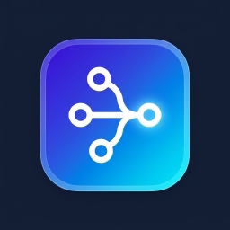

<div align="center">
  

  <h1><b>Sublink Hub</b></h1>
  <p><b>轻量级多源订阅聚合与自适应分发服务（基于 Cloudflare Workers + D1）</b></p>
</div>

## 项目简介

**Sublink Hub** 基于开源项目 [sublink-worker](https://github.com/7Sageer/sublink-worker) 增强改造，专为个人使用场景设计：云端集中维护多个上游订阅源与组合策略，通过独立的专有链接按客户端自动下发适配格式，免去手动拼装与反复转换订阅的繁琐。

### 核心增强特性

- **多订阅源集中管理**：支持添加多个上游订阅链接并设置自定义别名，默认遮蔽真实订阅 URL，支持手动刷新、失败保留旧缓存与脱敏节点预览。
- **自定义组合与合并去重**：支持自由勾选并排序多个订阅源合并为独立列表，自动添加来源别名前缀与重名后缀，并基于完整连接参数指纹智能去重。
- **专有链接隔离分发**：可创建多个不同组合的订阅列表，各自拥有高强度随机专有链接（`/sub/<token>`），支持一键复制与即时重置/停用。
- **多格式统一解析与转换**：自动兼容 Clash YAML、Base64、URI 列表、Sing-Box JSON、Surge INI 等上游输入，统一转为内部节点模型后按需输出。
- **客户端自适应下发**：自动识别下游客户端 `User-Agent`（Clash / Mihomo、Shadowrocket / v2rayN、Sing-Box、Surge），同时支持 `?target=` 与 `?mode=provider` 显式指定输出格式。
- **安全与防泄露**：单管理员登录认证（PBKDF2 + HttpOnly Cookie + 登录限流）、可选字段级 AES-GCM 加密存储、严格同源校验及防缓存响应头，避免订阅链接与节点凭据泄露。

---

## 快速部署（Cloudflare Workers + D1）

只需 **Cloudflare Workers + D1**（Free 套餐即可运行），无需 Node 运行时服务器、Redis 或外部数据库。

### 1. 安装依赖

```bash
npm install
```

### 2. 创建并初始化 D1 数据库

```bash
# 创建 D1 数据库，将返回的 database_id 填入 wrangler.toml 的 HUB_DB
npx wrangler d1 create sublink-hub

# 执行建表迁移
npx wrangler d1 migrations apply sublink-hub --remote
```

### 3. 配置管理员密码与加密密钥

```bash
# 必填：设置管理员登录密码（按提示输入密码）
node scripts/hash-password.mjs | npx wrangler secret put ADMIN_PASSWORD_HASH

# 推荐（可选）：生成 32 字节密钥，加密存储 D1 中的上游链接、节点缓存与订阅 Token
node scripts/hash-password.mjs --gen-key | npx wrangler secret put DATA_ENCRYPTION_KEY
```

> 请勿在开始添加订阅源后随意更换 `DATA_ENCRYPTION_KEY`，否则已加密的历史数据将无法解密。

### 4. 部署上线

```bash
npx wrangler deploy
```

---

## 路由与客户端使用

| 路径 | 用途 |
| --- | --- |
| `/login` | 管理员登录页 |
| `/admin` | 订阅源管理、组合列表编排与节点预览后台 |
| `/sub/<token>` | 专有订阅链接（按客户端 `User-Agent` 自动识别输出格式） |
| `/sub/<token>?target=<format>` | 显式指定输出格式：`mihomo`、`base64`、`singbox`、`surge` |
| `/sub/<token>?target=mihomo&mode=provider` | 仅输出 `proxies` 列表，供 Mihomo `proxy-providers` 使用 |

### 配合 Clash Verge Rev 扩展脚本

1. 在管理后台复制组合列表的 `?target=mihomo` 链接并导入 Clash Verge Rev。
2. 服务端下发最小可用配置（仅包含节点列表 `proxies` 与基础 `PROXY` 组），DNS、TUN、策略组与分流规则全部交由本地扩展脚本读取 `config.proxies` 独立接管。

---

## 运维与安全说明

- **重置管理员密码**：重新执行 `node scripts/hash-password.mjs | npx wrangler secret put ADMIN_PASSWORD_HASH`；如需立即踢出已有登录会话，执行：
  ```bash
  npx wrangler d1 execute sublink-hub --remote --command "DELETE FROM sessions;"
  ```
- **版本回滚**：使用 `npx wrangler rollback` 回退 Worker 版本；D1 数据与迁移保持不变。
- **本地开发与测试**：
  ```bash
  npm test
  ```

---

## 致谢与协议

- 本项目基于 [7Sageer/sublink-worker](https://github.com/7Sageer/sublink-worker) 开发，保留原转换解析核心与运行时架构。
- 遵循 [MIT License](LICENSE) 开源协议。本项目仅用于学习与技术交流，请遵守当地法律法规。
